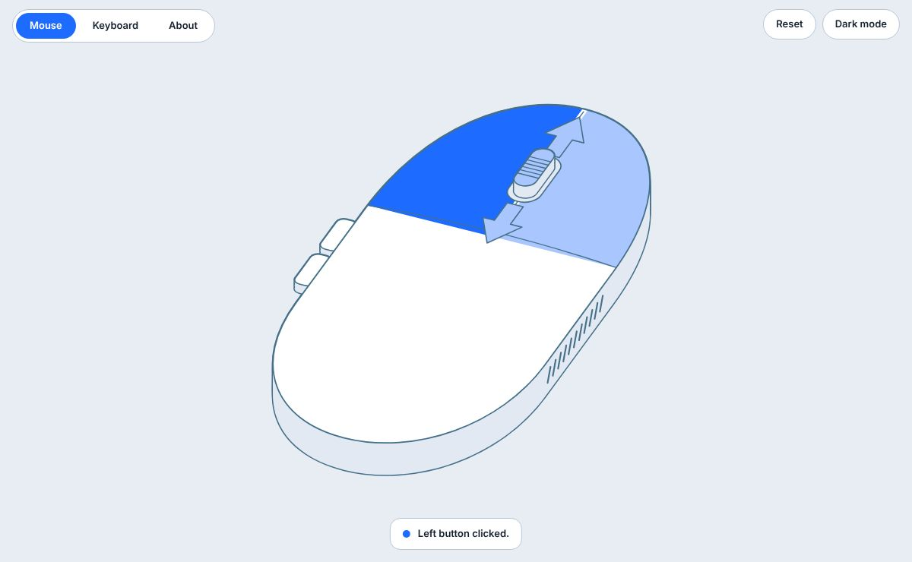
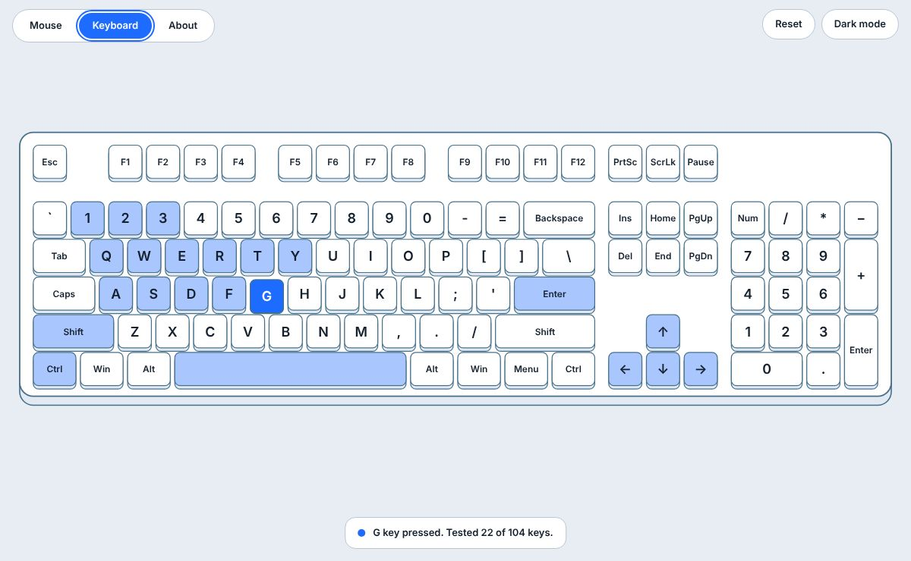
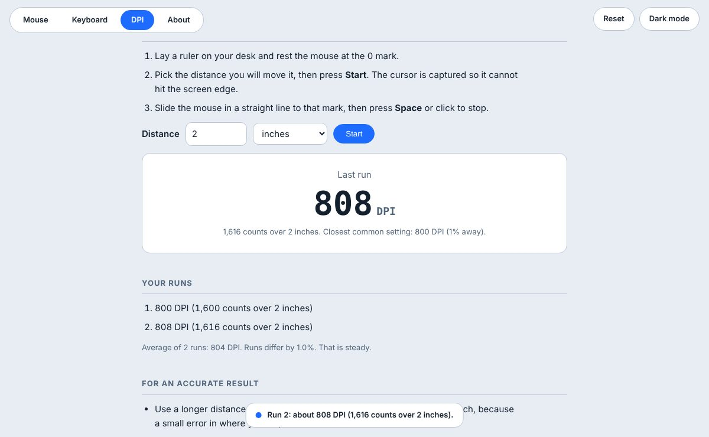
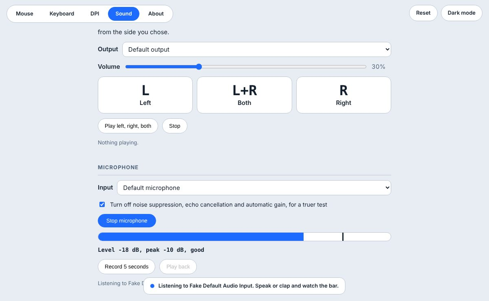

<div align="center">


# Mouse and Keyboard Test

**Check every click, every key, your mouse DPI, your speakers and your microphone.**<br>
Free, private and runs right in your browser. No account, nothing uploaded.


[**Open the web app**](app/) &nbsp;·&nbsp; [**Download for desktop**](#download) &nbsp;·&nbsp; [**Release notes**](#whats-new-in-121) &nbsp;·&nbsp; [**Support**](#support-the-developer)

<picture>
  <source media="(prefers-color-scheme: dark)" srcset="assets/mouse-dark.jpg">
  
</picture>

</div>

---

## Features

| Tab | What it does |
|---|---|
| **Mouse** | Lights up the left, middle and right buttons and the back and forward side buttons. The scroll wheel shows up and down arrows with a count for each direction. Parts you have already tested keep a lighter tint, so you can see what is left. |
| **Keyboard** | The full 104-key layout with a running count of keys tested. Each key lights up while you hold it, then keeps a lighter tint. |
| **DPI** | Measures your mouse's DPI. Move the mouse a distance you set with a ruler, and the test counts how far it reports moving. Shows the closest common setting and keeps the average of several runs. |
| **Sound** | Plays three beeps through the **left**, the **right** or **both** speakers. Choose the output device and volume. Test any **microphone** with a live level and peak meter, then record 5 seconds and play it back. |
| **About** | Version, developer contact, ways to support the project, credits and terms. |

**Problem notes** appear when a button or key registers two presses in under 60 ms, when the scroll wheel suddenly reverses direction, and when nothing has been pressed for a few seconds. Each test has its own **Reset** button, and there is a light and dark mode.

## Screenshots

<table>
  <tr>
    <td width="50%">
      <picture>
        <source media="(prefers-color-scheme: dark)" srcset="assets/keyboard-dark.jpg">
        
      </picture>
      <p align="center"><b>Keyboard</b></p>
    </td>
    <td width="50%">
      <picture>
        <source media="(prefers-color-scheme: dark)" srcset="assets/dpi-dark.jpg">
        
      </picture>
      <p align="center"><b>DPI</b></p>
    </td>
  </tr>
  <tr>
    <td width="50%">
      <picture>
        <source media="(prefers-color-scheme: dark)" srcset="assets/sound-dark.jpg">
        
      </picture>
      <p align="center"><b>Sound</b></p>
    </td>
    <td width="50%">
      <picture>
        <source media="(prefers-color-scheme: dark)" srcset="assets/mouse-dark.jpg">
        
      </picture>
      <p align="center"><b>Mouse</b></p>
    </td>
  </tr>
</table>

## Quick start

### Use it in the browser

Open the web app. Nothing to install.

- **Live site:** `https://YOUR-USERNAME.github.io/YOUR-REPOSITORY/` (see [Deploy on GitHub Pages](#deploy-on-github-pages))
- **Web app:** `/app/`
- **Jump to a tab:** add `#keyboard`, `#dpi`, `#sound` or `#about` to the address, for example `/app/#sound`.

### Download

The desktop apps are in [`downloads/`](downloads/) and on the website. Each one opens the test in its own window, using the Microsoft Edge, Google Chrome, Brave or Chromium you already have.

| Platform | File | Size | Needs |
|---|---|---|---|
| Windows | [`MouseKeyboardTest-Windows.zip`](downloads/MouseKeyboardTest-Windows.zip) | 2.2 MB | Windows 10 or 11 with Microsoft Edge or Chrome |
| macOS | [`MouseKeyboardTest-macOS.zip`](downloads/MouseKeyboardTest-macOS.zip) | 4.2 MB | macOS 11 or later, Intel or Apple silicon, with Chrome, Edge or Brave |
| Linux | [`MouseKeyboardTest-Linux.zip`](downloads/MouseKeyboardTest-Linux.zip) | 2.1 MB | 64-bit Linux with Chrome, Chromium, Edge or Brave |

<details>
<summary><b>Install steps for each system</b></summary>

**Windows.** Unzip, then double-click `Mouse and Keyboard Test.exe`. Windows may warn about an unknown publisher because the app is not code-signed. Choose **More info**, then **Run anyway**.

**macOS.** Unzip and drag the app to Applications. The first time, right-click it, choose **Open**, then **Open** again to confirm.

**Linux.** Unzip and run `./MouseKeyboardTest`. If it will not start, run `chmod +x MouseKeyboardTest` first.

</details>

<details>
<summary><b>Verify your download</b></summary>

Compare the checksum of the file you downloaded with [`downloads/SHA256SUMS.txt`](downloads/SHA256SUMS.txt).

```text
ca39ab8ac9bf93aaa219f615d55ad938e7ec03d46181e771e847b9e17ef817b7  MouseKeyboardTest-Windows.zip
c5d14f8a96228ae479e0e52b4d41c3bd560dc5f8c22d3ef7701ae10faf23426f  MouseKeyboardTest-macOS.zip
f56e851c03552d8b7672f2ff4f61bc64ef5a79515296b91e3183cd7b35cd9107  MouseKeyboardTest-Linux.zip
```

| System | Command |
|---|---|
| Linux | `sha256sum MouseKeyboardTest-Linux.zip` |
| macOS | `shasum -a 256 MouseKeyboardTest-macOS.zip` |
| Windows (PowerShell) | `Get-FileHash MouseKeyboardTest-Windows.zip` |

</details>

## Privacy

- The tests run **entirely on your device**. Key presses, clicks and movements are never collected, stored or sent anywhere.
- The microphone is only on while you run the test, and it is released as soon as you leave the Sound tab. The live signal is never played through your speakers.
- A recording stays in memory and is discarded when you leave the Sound tab, press Reset or close the page.
- The only thing saved is your light or dark mode choice.

## Good to know

- **Some keys are reserved by your system** (for example the Windows key or Ctrl+W). A key that does not light up may be reserved, so test it in another program before deciding it is broken.
- **DPI is an estimate.** It depends on how carefully you measure the distance and on your pointer settings. Use a longer distance (4 inches or 10 cm), move in a straight line, turn off pointer acceleration, and compare two or three runs.
- **Microphone permission.** The desktop apps open with a fresh temporary browser profile, so they ask for microphone permission every time. Real device names appear only after you allow the microphone.
- **Choosing the output device** works in Chrome, Edge and other Chromium browsers. Other browsers use the system default.
- **Wrong side or no sound?** Check the balance in your system sound settings and the cable or Bluetooth connection, then try another app.

## Deploy on GitHub Pages

The whole project is plain static files. There is no build step.

1. Create a new repository on GitHub.
2. Upload the contents of this folder to the repository root: `index.html`, `app/`, `assets/`, `downloads/`, `launcher/` and `README.md`.
3. Open **Settings → Pages**. Under **Build and deployment**, set **Source** to **Deploy from a branch**, choose **main** and **/ (root)**, then **Save**.
4. After a minute or two the site is live at `https://YOUR-USERNAME.github.io/YOUR-REPOSITORY/`, with the web app at `/app/`.

All links are relative, so it also works from a custom domain or from a repository named `YOUR-USERNAME.github.io`.

To preview locally:

```bash
python3 -m http.server 8000
# then open http://localhost:8000
```

## Project structure

```text
.
├── index.html          Landing page and downloads
├── app/
│   └── index.html      The web app (one self-contained file)
├── assets/             Screenshots and favicon
├── downloads/          Zipped desktop apps and SHA256SUMS.txt
├── launcher/           Go source and build script for the desktop apps
│   ├── main.go
│   ├── go.mod
│   └── build.sh
└── README.md
```

## Build the desktop apps

The apps are a small launcher written in [Go](https://go.dev) (standard library only). It embeds `app/index.html`, serves it on `127.0.0.1` and opens it as a standalone window in an installed Chromium-based browser. If none is found, it opens your default browser and quits when the tab closes.

Because the apps contain a copy of the web app, rebuild them whenever `app/index.html` changes.

1. Install Go 1.22 or newer.
2. Run `sh launcher/build.sh`. It writes the Windows, macOS (Intel and Apple silicon) and Linux binaries to `launcher/dist/`.
3. Zip them in the layout the current downloads use:
   - **Windows:** the `.exe` and a `README.txt`
   - **Linux:** `MouseKeyboardTest` and a `README.txt`
   - **macOS:** the `Mouse and Keyboard Test.app` bundle with `mkt-x86_64`, `mkt-arm64` and the small `MouseKeyboardTest` shell script, plus a `README.txt`

   Keep the executable bit on the Linux and macOS files.
4. Put the zips in `downloads/`, then update `SHA256SUMS.txt` and the sizes and checksums in the Downloads section of `index.html` and in this README.

## What's new in 1.2.1

- **About tab and website:** a new *Support the developer* section with donation addresses and copy buttons, plus Facebook, Discord and Steam links.
- Version 1.2.1 across the app, About page, website and macOS bundle.

**1.2.0** added the **Sound** tab: left, right and both speaker tests, output device and volume, and a microphone test with a live level meter, record and play back. **1.1.0** added the **DPI** tab. **1.0.0** was the first release.

## Support the developer

Mouse and Keyboard Test is free. If it helped you and you would like to say thanks, a donation helps pay for the time to keep improving it. It is entirely optional.

| Coin | Address |
|---|---|
| $WEMIX | `0x096605352effe89ac90da09a735718096b86bf6c` |
| $BTC | `bc1q0972yhewhpxrew3nvm307t328njmszupcdhxwl` |
| $USDT | `0x0f8504fc596822af84b0e2176794a622d35af334` |

> [!WARNING]
> Check the address carefully and **confirm the network with the developer before you send**. A payment sent on the wrong network cannot be recovered. Donations are voluntary gifts. They do not buy support, features or any guarantee.

Prefer another donation platform? Contact the developer by email, Discord or Facebook.

## Contact

**Shinjuu**, designer and developer. Questions, bug reports and ideas for new tests are welcome.

[](mailto:fsociety.shinjuu@gmail.com)
[](https://www.facebook.com/fsocietyshinjuu)
[](#contact)
[](https://steamcommunity.com/id/shinjuu0912)

Discord username: `shinjuu0912`

## Credits

- Designed and developed by Shinjuu.
- Built with the help of Claude, an AI assistant made by Anthropic.
- Inspired by the mouse and keyboard tests at onlinemictest.com. This software is independent and has no affiliation with Online Mic Test, and it uses none of its code or artwork.

## License and terms

Copyright © 2026 Shinjuu. **All rights reserved.** This is not an open-source project.

The software is free to use for personal and business purposes, such as testing your own devices or devices you are checking for someone else. You may share the unmodified app and its link. You may not sell it, remove the credits, or present it as your own work. The full terms are in the About tab of the app and at the bottom of the website. The software is provided "as is", without warranty of any kind.
